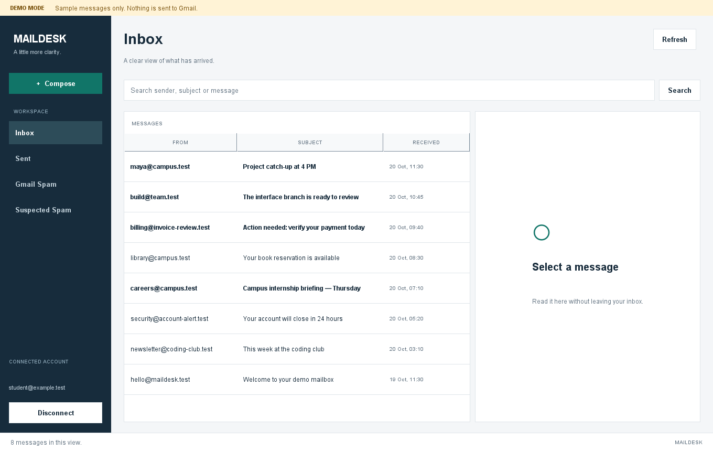

# Maildesk

[](https://github.com/Sanjay-AI-ML/email-management-work/actions/workflows/verify.yml)

A Java desktop email client with Gmail integration, MySQL persistence, and
explainable spam review. Built with Swing, JDBC, and the Gmail REST API.



## Features

- Sign in through Google OAuth with PKCE and a protected local token cache.
- Browse Inbox, Sent, and Gmail Spam; search cached messages and compose plain-text emails.
- Review rule-based spam scores and save corrections.
- Store messages, labels, and feedback in an account-scoped MySQL database.
- Run a standalone demo with fictional messages and simulated sends.

The sample imports **up to 18 unique messages**: six recent messages each from
Inbox, Sent, and Spam. Connection and Refresh use the same limit. Refresh replaces
the local sample without deleting messages from Gmail. Search covers cached mail;
sent messages can add a local Sent copy until the next refresh.

## Requirements

- JDK 17 or newer
- MySQL 8
- A Google account and a Desktop OAuth client with the Gmail API enabled

The Maven Wrapper downloads build dependencies automatically. The standalone demo
and default tests run without Google credentials or a MySQL server.

## Get started

```powershell
git clone https://github.com/Sanjay-AI-ML/email-management-work.git
cd email-management-work
Copy-Item config/app.properties.example config/app.properties
```

Set the database login in `config/app.properties` and save your downloaded Google
Desktop OAuth JSON as `config/credentials.json`. Follow the [setup guide](docs/SETUP.md)
for database permissions and Google consent configuration.

```powershell
.\mvnw.cmd --batch-mode clean package
.\scripts\run-app.ps1 -NoBuild --check-setup
.\scripts\run-app.ps1 -NoBuild
```

Click **Connect Gmail** to authorize the application and load the sample mailbox.
The packaged application can also be launched with `java -jar target/maildesk.jar`
from the project directory. On Linux/macOS, build with `./mvnw clean package`.

To explore the interface without external services:

```powershell
.\scripts\run-demo.ps1
```

## Windows executable

Create a portable Windows application with a bundled Java runtime:

```powershell
.\scripts\package-windows.ps1 -JdkPath 'C:\path\to\temurin-jdk-17'
```

The output is `package/Maildesk/Maildesk.exe` and the shareable
`package/Maildesk-Windows-x64.zip`. Extract the entire ZIP before running the
executable. MySQL and local Gmail configuration are still required; a separate
Java installation is unnecessary. See [Windows packaging](docs/WINDOWS.md).

## Verification

```powershell
.\scripts\check.ps1          # Unit, integration, contract, and headless UI checks
.\scripts\check.ps1 -MySql   # Include the configured local MySQL server
.\scripts\check.ps1 -Render  # Save UI previews under build/previews
```

Tests use isolated H2 databases and local HTTP fixtures. The opt-in MySQL test
creates and removes its own fixture account; automated tests send no actual email.
GitHub Actions builds and tests on Windows and Linux with JDK 17.

## Project structure

| Path | Purpose |
| --- | --- |
| `src/main/java/ems/ui` | Swing interface |
| `src/main/java/ems/gmail` | OAuth, Gmail requests, and MIME handling |
| `src/main/java/ems/service` | Application services and shared UI contract |
| `src/main/java/ems/storage` | Transactional JDBC persistence |
| `src/main/java/com/emailapp/spam` | Explainable spam rules |
| `src/demo/java` | Standalone demo |
| `src/test/java` | Automated verification |
| `sql/schema.sql` | MySQL schema |

See [architecture](docs/ARCHITECTURE.md) for the component flow and data model.
OAuth credentials, tokens, database passwords, and private email exports are
excluded from version control. Attachments, rich-text composition, and scheduled
synchronization are outside the current scope.
